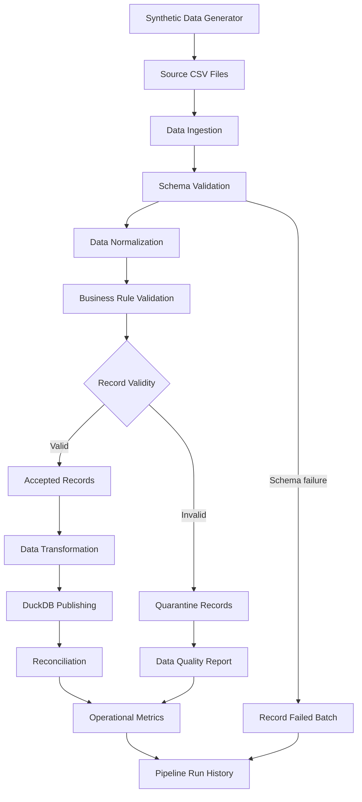

# DataGuard - System Architecture

## 1. Overview

DataGuard is a modular, test-driven data engineering pipeline.

It processes synthetic retail transaction data through ingestion,
schema validation, business-rule validation, transformation,
analytical publishing and reconciliation.

The architecture prioritizes correctness, traceability,
reproducibility and failure recovery.

## 2. Technology Architecture

| Component | Technology |
|---|---|
| Data generation | Python, Faker, NumPy |
| Ingestion | Python, Pandas |
| Validation | Python, Pandas |
| Data transformation | Python, Pandas |
| Analytical storage | DuckDB |
| Automated testing | Pytest |
| Test coverage | pytest-cov |
| Version control | Git, GitHub |

## 3. Data Flow



## 4. Component Responsibilities

### 4.1 Synthetic Data Generator

Generates customers, products, orders and order items.

Supports:
- Small reproducible sample datasets.
- Configurable larger datasets.
- Fixed random seeds.
- Valid records and deliberately labelled anomalies.

### 4.2 Data Ingestion

Reads source CSV files.

Responsible for:
- Reading the expected source files.
- Tracking filenames.
- Recording source row numbers.
- Associating records with a run ID.
- Handling unreadable or malformed files.

### 4.3 Schema Validation

Checks:
- Expected column names.
- Missing required columns.
- Unexpected columns.
- Required source fields.
- Expected data types.

Missing or unexpected columns cause a batch-level schema failure.

### 4.4 Data Quality Engine

Validates:
- Primary key uniqueness.
- Required fields.
- Null values.
- Numeric boundaries.
- Foreign key relationships.
- Business rules.
- Financial calculations.

Individual invalid records are quarantined with explicit rejection reasons.

### 4.5 Transformation

Transforms accepted source records into the warehouse structure.

Responsibilities:
- Monetary calculations.
- Deterministic surrogate key assignment.
- Date dimension generation.
- Mapping source identifiers to warehouse keys.
- Preparation of fact and dimension records.

### 4.6 DuckDB Publishing

Publishes validated data into:
- dim_customer
- dim_product
- dim_order
- dim_date
- fact_sales

Publishing must be transactional and support safe full-refresh reruns.

### 4.7 Reconciliation

Verifies:
- Source-to-target row counts.
- Rejected record counts.
- Primary key uniqueness.
- Referential integrity.
- Quantity totals.
- Gross and net amounts.
- Completed sales revenue.

### 4.8 Monitoring

Records:
- run_id
- started_at_utc
- ended_at_utc
- status
- input_row_count
- valid_row_count
- rejected_row_count
- output_row_count
- execution_time_seconds
- failure_reason

## 5. Data Validation Flow

Validation follows entity dependencies.

1. Validate customers.
2. Validate products.
3. Validate orders using accepted customers.
4. Validate order items using accepted orders and products.
5. Validate financial calculations.

Exact duplicate records retain one deterministic occurrence.

Conflicting duplicate business keys are quarantined.

Invalid references are rejected.

## 6. Failure Handling

Batch-level failures:
- Missing source file.
- Unreadable file.
- Missing required column.
- Unexpected source column.

Record-level failures:
- Missing required value.
- Invalid data type.
- Duplicate business identifier.
- Invalid reference.
- Business-rule violation.

Warehouse publishing uses a transaction so incomplete changes
are not committed.

Each execution receives a separate run ID.

## 7. Historical and Late-Arriving Data

Transaction timestamps represent business event time.

Out-of-order records are not rejected merely because of
their arrival sequence.

Late-arriving transactions are included in the next complete
source snapshot.

The current implementation uses full-refresh processing.

Slowly Changing Dimension Type 2 history is outside the
initial implementation scope.

## 8. Automated Testing Architecture

Pytest will verify:

- Individual validation functions.
- Schema contracts.
- Boundary conditions.
- Malformed inputs.
- Duplicate resolution.
- Referential integrity.
- Complete pipeline execution.
- Warehouse reconciliation.
- Idempotency.
- Failure rollback and retry.

Integration tests will use temporary input files and
isolated DuckDB databases.

## 9. Design Trade-offs

The solution uses local CSV files and DuckDB instead of
external cloud services to keep development reproducible.

Full-refresh publishing simplifies reruns and recovery,
but is not an incremental CDC implementation.

Synthetic data avoids unauthorized access to real
customer information.

The design prioritizes correctness and test evidence
over infrastructure complexity.
```

Save using `Ctrl + S`.

## 5. Verify the architecture document

Run:

```powershell
Get-ChildItem docs
```

Expected:

```text
.gitkeep
architecture.md
data_dictionary.md
```

You can preview the Mermaid diagram directly on GitHub inside this Markdown file.

---

# 6. One important technical decision

Our chosen financial data types are `DECIMAL(12,2)` and `DECIMAL(14,2)`.

This is deliberate: DuckDB supports fixed-precision decimal types, which are suitable for monetary calculations. Its documentation also explains that decimal division can produce floating-point results, so our calculations will avoid unnecessary division and use Python's `Decimal` for money validation. <Cite refs={["turn874445search0","turn874445search3"]}/>

We'll also explicitly test database constraints for primary and foreign keys, and measure their performance impact instead of assuming that adding more constraints is always faster. <Cite refs={["turn874445search1","turn874445search2"]}/>

# 7. Our next milestone

<box border radius="lg" padding={3} gap={2}>
  **Phase 2 progress**

  <row justify="between">
    Data dictionary
    <badge color="success">Verified</badge>
  </row>
  <row justify="between">
    Entity relationships
    <badge color="success">Designed</badge>
  </row>
  <row justify="between">
    Fact grain
    <badge color="success">Defined</badge>
  </row>
  <row justify="between">
    Business validation rules
    <badge color="success">Defined</badge>
  </row>
  <row justify="between">
    System architecture
    <badge color="warning">Document now</badge>
  </row>
</box>

After architecture, we will create a formal `docs/test_plan.md` mapping each hackathon requirement to a test case, input, expected result and acceptance criterion.

**Only after the architecture and test plan are documented will we give Claude Code our first implementation task: building the reproducible synthetic data generator.**

That way, the AI coding tools will implement a design we understand rather than inventing an architecture on our behalf.