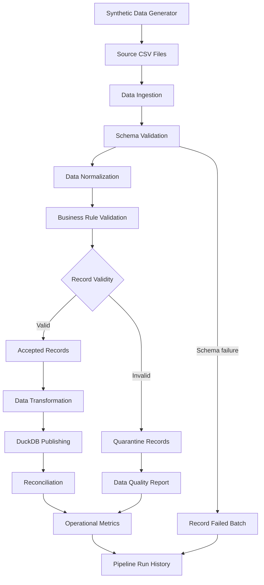

# DataGuard - System Architecture

## 1. Overview

DataGuard is a modular, test-driven data engineering pipeline.

It processes synthetic retail transaction data through ingestion,
schema validation, business-rule validation, transformation,
analytical publishing and reconciliation.

The architecture prioritizes correctness, traceability,
reproducibility and failure recovery.

## 2. Technology Architecture

| Component | Technology |
|---|---|
| Data generation | Python, Faker, NumPy |
| Ingestion | Python, Pandas |
| Validation | Python, Pandas |
| Data transformation | Python, Pandas |
| Analytical storage | DuckDB |
| Automated testing | Pytest |
| Test coverage | pytest-cov |
| Version control | Git, GitHub |

## 3. Data Flow

## 4. Component Responsibilities

### 4.1 Synthetic Data Generator

Generates customers, products, orders and order items as four
CSV source files.

Supports:
- A small reproducible sample dataset and configurable larger
  datasets of 100,000 or more order items.
- Fixed random seeds and deterministic sequential identifiers.
- Valid foreign-key relationships by construction.
- Configuration validation that rejects impossible row counts.
- Deterministic row shuffling for out-of-order arrival tests
  (later option).
- Deliberate anomaly injection (later step).

Expected anomaly labels are never written into source CSV files.
They are written to a separate manifest in an `_expected/`
directory beside the source files. The ingestion pipeline never
reads this directory.

Some generator rules (for example, unit_price equals list_price
and order items reference active products only) are generator
invariants, not pipeline validation rules. The pipeline does not
reject records that differ from them.

Generation rules, configuration constraints and the manifest
format are defined in docs/data_dictionary.md §16 and §17.

### 4.2 Data Ingestion

Reads source CSV files.

Responsible for:
- Reading the expected source files.
- Tracking filenames.
- Recording source row numbers.
- Associating records with a run ID.
- Handling unreadable or malformed files.
- Reading only the four expected source files by exact name;
  the `_expected/` manifest directory is never read.
- Numbering rows by physical CSV line (header = line 1,
  first data record = line 2).

### 4.3 Schema Validation

Schema validation runs per file, before any record is checked.

Checks:
- The file exists and is readable as CSV.
- A header row is present.
- All expected columns are present (column order does not matter).
- No unexpected columns are present.

Any failure is a batch-level schema failure.

Individual field values (required values, data types, allowed
values) are not checked here. They are record-level checks
performed by the Data Quality Engine.

### 4.4 Data Quality Engine

Validates:
- Parseable values of the expected data type.
- Primary key uniqueness.
- Required fields.
- Null values.
- Numeric boundaries.
- Foreign key relationships.
- Business rules.
- Financial calculations.

Individual invalid records are quarantined with explicit rejection reasons.

### 4.5 Transformation

Transforms accepted source records into the warehouse structure.

Responsibilities:
- Monetary calculations.
- Deterministic surrogate key assignment.
- Date dimension generation.
- Mapping source identifiers to warehouse keys.
- Preparation of fact and dimension records.

### 4.6 DuckDB Publishing

Publishes validated data into:
- dim_customer
- dim_product
- dim_order
- dim_date
- fact_sales

Publishing must be transactional and support safe full-refresh reruns.

### 4.7 Reconciliation

Verifies:
- Source-to-target row counts.
- Rejected record counts.
- Primary key uniqueness.
- Referential integrity.
- Quantity totals.
- Gross and net amounts.
- Completed sales revenue.

### 4.8 Monitoring

Records:
- run_id
- started_at_utc
- ended_at_utc
- status
- input_row_count
- valid_row_count
- rejected_row_count
- output_row_count
- execution_time_seconds
- failure_reason

Field definitions and storage rules are in docs/data_dictionary.md §13.

## 5. Data Validation Flow

Validation follows entity dependencies.

1. Validate customers.
2. Validate products.
3. Validate orders using accepted customers.
4. Validate order items using accepted orders and products.
5. Validate financial calculations.

Exact duplicate records retain one deterministic occurrence.

Conflicting duplicate business keys are quarantined.

Invalid references are rejected.

## 6. Failure Handling

Batch-level failures (the pipeline run is recorded as FAILED,
no analytical data is published, and run-level failure metadata
is preserved). A batch-level failure in any one of the four
required source files fails the entire run:
- Missing source file.
- Unreadable file.
- Empty file without a header row.
- Missing required column.
- Unexpected source column.
- Malformed file where parsing cannot safely continue or row
  boundaries cannot be established.

Record-level failures (only the affected row is quarantined with
reason codes; applies to rows that can be safely parsed):
- Row with an incorrect number of fields, when the parser can
  safely identify and recover the row (MALFORMED_ROW).
- Missing required value.
- Unparseable or wrong-typed value (for example `abc`, NaN or
  infinity in a numeric column).
- Value outside the allowed set or range.
- Duplicate business identifier.
- Invalid reference.
- Business-rule violation.

Warehouse publishing uses a transaction so incomplete changes
are not committed.

Each execution receives a separate run ID.

## 7. Historical and Late-Arriving Data

Transaction timestamps represent business event time.

Out-of-order records are not rejected merely because of
their arrival sequence.

Late-arriving transactions are included in the next complete
source snapshot.

The current implementation uses full-refresh processing.

Slowly Changing Dimension Type 2 history is outside the
initial implementation scope.

## 8. Automated Testing Architecture

Pytest will verify:

- Individual validation functions.
- Schema contracts.
- Boundary conditions.
- Malformed inputs.
- Duplicate resolution.
- Referential integrity.
- Complete pipeline execution.
- Warehouse reconciliation.
- Idempotency.
- Failure rollback and retry.

Integration tests will use temporary input files and
isolated DuckDB databases.

## 9. Design Trade-offs

The solution uses local CSV files and DuckDB instead of
external cloud services to keep development reproducible.

Full-refresh publishing simplifies reruns and recovery,
but is not an incremental CDC implementation.

Synthetic data avoids unauthorized access to real
customer information.

The design prioritizes correctness and test evidence
over infrastructure complexity.

Byte-identical reproducibility of generated data is guaranteed
only in the pinned software environment defined in
requirements.txt. It is not claimed for other environments.

## 10. Monetary Precision

Monetary columns use fixed-precision DECIMAL types:
DECIMAL(12,2) for prices, DECIMAL(14,2) for amounts and
DECIMAL(5,4) for discount_pct.

Python calculations use decimal.Decimal with ROUND_HALF_UP.
Binary floating-point is never used for monetary values.

In DuckDB, dividing DECIMAL values can produce a DOUBLE result,
so warehouse calculations avoid unnecessary division.

Primary- and foreign-key constraints will be tested, and their
performance impact measured rather than assumed.
